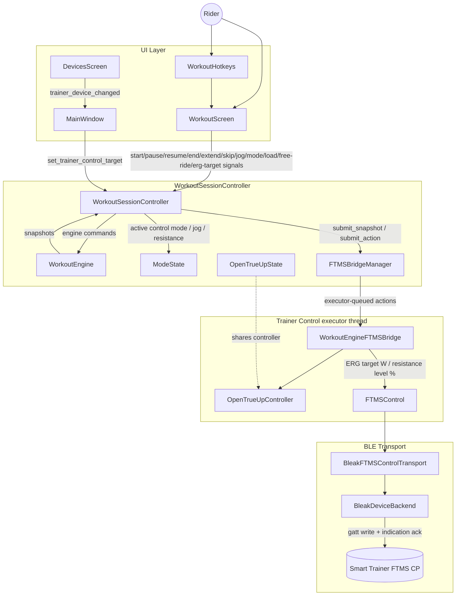
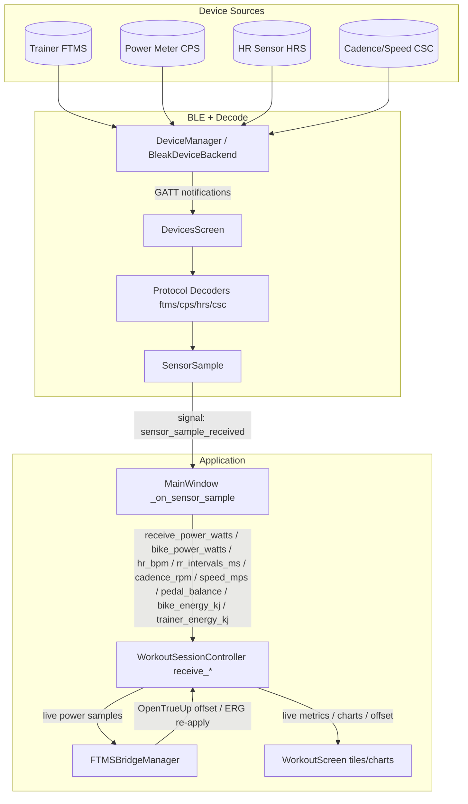
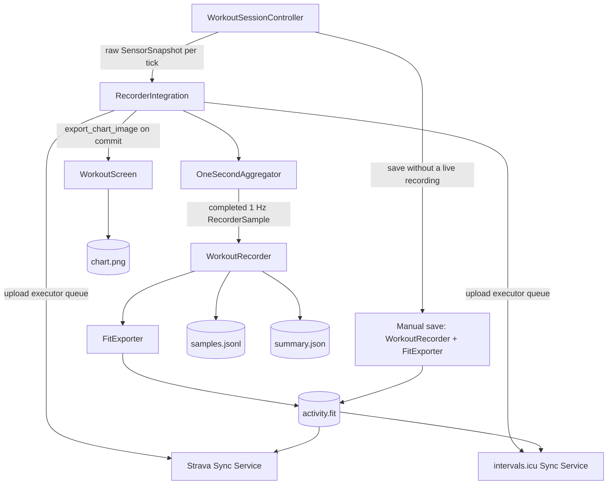
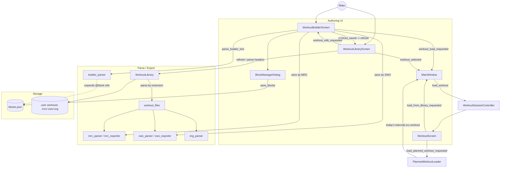
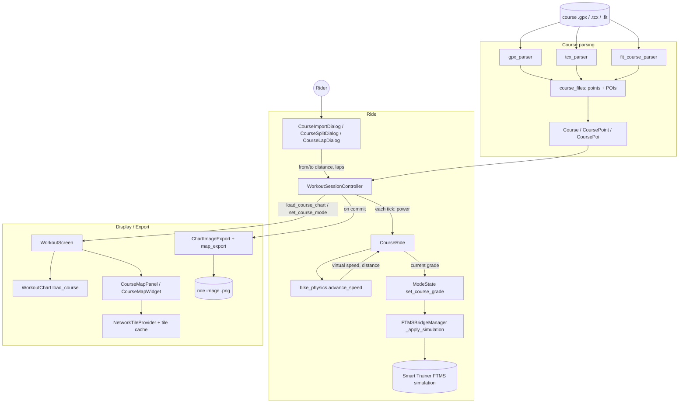
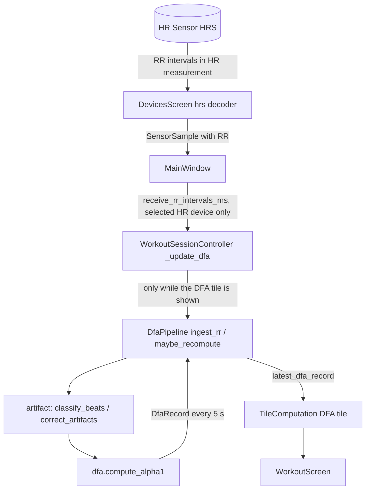

# OpenCycleTrainer Architecture Diagram

This diagram documents how control commands, live telemetry, recording, workout
authoring, course rides and DFA α1 route through the project modules.

## Control Command Routing (UI -> Trainer)

## Telemetry Routing (Devices -> UI)

## Recording/Export Routing (Controller -> Storage/Cloud)

## Workout Authoring Routing (Library / Builder / Blocks)

## Course Ride Routing (Course file -> Trainer grade / Chart / Map)

## DFA α1 Routing (HR strap -> Tile)

### Diagram Node Key

- `WorkoutHotkeys`: `opencycletrainer/ui/hotkeys.py`
- `WorkoutScreen`: `opencycletrainer/ui/workout_screen.py`
- `DevicesScreen`: `opencycletrainer/ui/devices_screen.py`
- `SettingsScreen`: `opencycletrainer/ui/settings_screen.py`
- `MainWindow`: `opencycletrainer/ui/main_window.py`
- `WorkoutSessionController`: `opencycletrainer/ui/workout_controller.py`
- `ModeState`: `opencycletrainer/ui/mode_state.py`
- `OpenTrueUpState`: `opencycletrainer/ui/opentrueup_state.py`
- `FTMSBridgeManager`: `opencycletrainer/ui/ftms_bridge_manager.py`
- `RecorderIntegration`, `SensorSnapshot`: `opencycletrainer/ui/recorder_integration.py`
- `WorkoutEngine`, `WorkoutEngineSnapshot`: `opencycletrainer/core/workout_engine.py`
- `WorkoutEngineFTMSBridge`, `FTMSControl`: `opencycletrainer/core/control/ftms_control.py`
- `OpenTrueUpController`: `opencycletrainer/core/control/opentrueup.py`
- `HybridModeController`: `opencycletrainer/core/control/hybrid_mode.py` (implemented + tested, not yet wired into the live UI)
- `OneSecondAggregator`: `opencycletrainer/core/one_second_aggregator.py`
- `DeviceManager`: `opencycletrainer/devices/device_manager.py` (abstract; `BleakDeviceBackend`, `MockDeviceBackend` implement it)
- `BleakDeviceBackend`, `BleakFTMSControlTransport`: `opencycletrainer/devices/ble_backend.py`
- `Protocol Decoders`: `opencycletrainer/devices/decoders/*` (ftms, cps, hrs, csc)
- `SensorSample`: `opencycletrainer/core/sensors.py`
- `WorkoutRecorder`, `RecorderSample`: `opencycletrainer/core/recorder.py`
- `FitExporter`: `opencycletrainer/core/fit_exporter.py`
- `Strava Sync Service`: `opencycletrainer/integrations/strava/sync_service.py` (FIT upload only)
- `intervals.icu Sync Service`: `opencycletrainer/integrations/intervalsicu/sync_service.py`; FTP sync in `ftp_service.py` and `ui/ftp_sync.py`; planned workouts in `planned_workouts.py` and `ui/planned_workout_loader.py`
- `gpx_parser` / `tcx_parser` / `fit_course_parser` / `course_files`: `opencycletrainer/core/`
- `Course`, `CoursePoint`, `CoursePoi`: `opencycletrainer/core/course_model.py`
- `CourseRide`: `opencycletrainer/core/course_ride.py`; `bike_physics`: `opencycletrainer/core/bike_physics.py`
- `CourseImportDialog` and friends: `opencycletrainer/ui/course_import_dialog.py`
- `CourseMapPanel` / `CourseMapWidget`: `opencycletrainer/ui/course_map.py`; tiles in `opencycletrainer/ui/map_tiles.py`
- `ChartImageExport`: `opencycletrainer/ui/chart_export.py`; map drawing in `opencycletrainer/ui/map_export.py`
- `DfaPipeline`: `opencycletrainer/core/dfa/pipeline.py`; maths in `core/dfa/dfa.py`, artifact correction in `core/dfa/artifact.py`
- `PlannedWorkoutLoader`: `opencycletrainer/ui/planned_workout_loader.py`
- `WorkoutLibraryScreen`: `opencycletrainer/ui/workout_library_screen.py`
- `WorkoutBuilderScreen`: `opencycletrainer/ui/workout_builder_screen.py`
- `BlockManagerDialog`: `opencycletrainer/ui/block_manager_dialog.py`
- `WorkoutLibrary`: `opencycletrainer/core/workout_library.py`
- `builder_parser`: `opencycletrainer/core/builder_parser.py`
- `mrc_parser` / `mrc_exporter`: `opencycletrainer/core/mrc_parser.py`, `opencycletrainer/core/mrc_exporter.py`
- `zwo_parser` / `zwo_exporter`: `opencycletrainer/core/zwo_parser.py`, `opencycletrainer/core/zwo_exporter.py`
- `erg_parser`: `opencycletrainer/core/erg_parser.py`
- `workout_files`: `opencycletrainer/core/workout_files.py`
- `blocks` store: `opencycletrainer/storage/blocks.py`
- Supporting pieces not drawn: settings (`storage/settings.py`, `ui/settings_screen.py`), credentials (`integrations/keyring_support.py` with a file fallback in `integrations/intervalsicu/key_store.py`; `integrations/strava/token_store.py`), spin-down (`core/control/spin_down.py`, `ui/spin_down_dialog.py`), capabilities dialogs (`ui/*_capabilities_dialog.py`), paired-device autoconnect (`storage/paired_devices.py`, `DevicesScreen.start_autoconnect`), OpenTrueUp offsets (`storage/opentrueup_offsets.py`), toasts (`ui/toast.py`)

## Notes

- `WorkoutSessionController` is the central integration point. Trainer control and live
  recording go through dedicated collaborators: `FTMSBridgeManager`, `RecorderIntegration`,
  `ModeState`, `OpenTrueUpState`, `PauseState`, `ChartHistory`, `TileComputation`,
  `PowerHistory`, and `TrainerConnection`. It also owns `DfaPipeline`, `ExternalEnergyTracker`,
  `CadenceHistory`, `PedalingDetector` and `IntervalStats`, plus a `WorkoutRecorder` and
  `FitExporter` of its own for saving a ride manually.
- `FTMSBridgeManager` owns the `WorkoutEngineFTMSBridge` and a single-worker
  `ThreadPoolExecutor`, so all blocking BLE control-point writes (with their indication
  acks) run off the Qt UI thread. Snapshots, power samples, and jog/mode actions are
  submitted as queued executor tasks.
- `RecorderIntegration` feeds raw per-tick sensor snapshots through a `OneSecondAggregator`,
  so the recorder only ever receives deterministic 1 Hz bins regardless of tick jitter. It
  also owns kJ accumulation and two background executors: one for saving and one queueing
  FIT uploads to Strava and intervals.icu.
- Cadence source selection uses priority: dedicated cadence sensor > power meter > trainer.
  Power metrics prefer the bike power meter (CPS), falling back to trainer (FTMS) power.
- OpenTrueUp receives both trainer and bike power samples through the bridge, computes an
  offset, and can trigger an ERG target re-application on the trainer.
- The workout authoring subsystem (Library + Builder + reusable Blocks) parses and exports
  MRC and ZWO files, and also reads ERG files (targets in watts, scaled to the rider's FTP
  when the file states the FTP it was written for). `workout_files` picks the parser by
  file extension for the library, the builder and the workout tab. The builder's `@name` block references are expanded by `builder_parser`
  from `blocks.json` at the current FTP; block bodies cannot themselves reference blocks
  (single-level nesting only).
- On a course ride, `CourseRide` turns rider power into virtual speed with `bike_physics`
  and feeds the current grade to `ModeState`, which the bridge sends as an FTMS simulation
  command. The map is drawn from cached tiles and also composed into the saved ride image.
- DFA α1 is computed only while its tile is shown, from RR intervals of the selected HR
  device, recomputed every 5 seconds after artifact correction.
- `HybridModeController` (`core/control/hybrid_mode.py`) is still not wired into the live UI;
  Hybrid mode runs its own logic in `ui/mode_state.py`.
