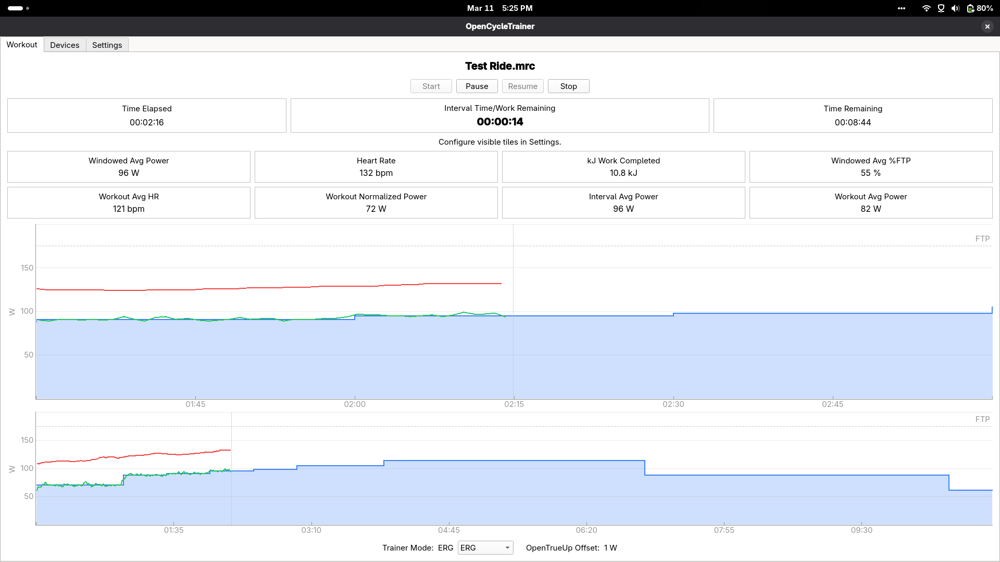

# OpenCycleTrainer

OpenCycleTrainer is a cross-platform open-source workout player for indoor bike training for desktop devices based on Python and PySide6.

## Features
* Graphical and numeric workout interface
* Configurable data fields
* Import of .mrc, .zwo and .erg files for custom workouts
* Load the ride planned for today on your intervals.icu calendar with one click
* FIT file export
* ERG and Resistance mode control of Bluetooth FTMS trainers
* Power matching between trainer and on-bike power meter (OpenTrueUp)
* Hybrid control mode which uses ERG for recovery intervals and returns to the last-used Resistance level for work intervals (helpful for VO2max intervals)
* Simulation mode which has the trainer simulate a road grade (FTMS indoor bike simulation), adjustable via the jog hotkeys
* Ride a GPX, TCX or FIT course: the trainer follows the course's grade while your power drives a virtual speed along its elevation profile
* Points of interest from the course file (summits, water, food, hazards, GPX waypoints) marked on the elevation profile and map; hover one for its details and how far ahead it is
* Elevation gain tile with the climbing done and still to come on a course
* Ride a whole course, just part of it (from/to a chosen distance), or several laps of it, with each lap recorded as a FIT lap
* Course elevation profile with a zoomed-in view of the road ahead (configurable span) and climbs coloured by grade
* Collapsible, resizable course map beside the charts (cached tiles from OpenStreetMap, CyclOSM, OpenTopoMap or Thunderforest with your API key; the route still shows offline): route still to ride in red, ridden in green, following the rider or showing the whole route. Can be turned off in Settings. The whole-route map is also drawn beside the chart in the ride image saved at the end of a course ride
* Selectable road surface (smooth road to loose gravel) that sets rolling resistance for simulated rides
* Metric or imperial units for speed, distance, elevation and weight
* Jog current power target or resistance in 1 or 5% steps via hotkeys
* Extend or skip current interval via hotkeys
* Send calibration command to bike-based power meters
* Lightweight application, fast loading of workouts, no account, subscription, or internet access required!
* No telemetry or privacy invasions required!

## Building installers
Run one command from the repository root; it fetches its own tools, updates dependencies, runs the tests and writes the installer to `dist/`:

* Windows MSI: `scripts\build_windows.cmd`
* Linux Flatpak: `scripts/build_linux.sh`

Add `-Upgrade` / `--upgrade` to move dependencies to their newest allowed versions. See [packaging/README.md](packaging/README.md) for prerequisites and options.

## Future possibilities
* Import additional filetypes
* More configurability of data fields and app behavior
* Calculation and display of DFAalpha1 during workout
* Export custom data from workout, such as trainer/PM offset, left/right balance, DFAalpha1, etc.

